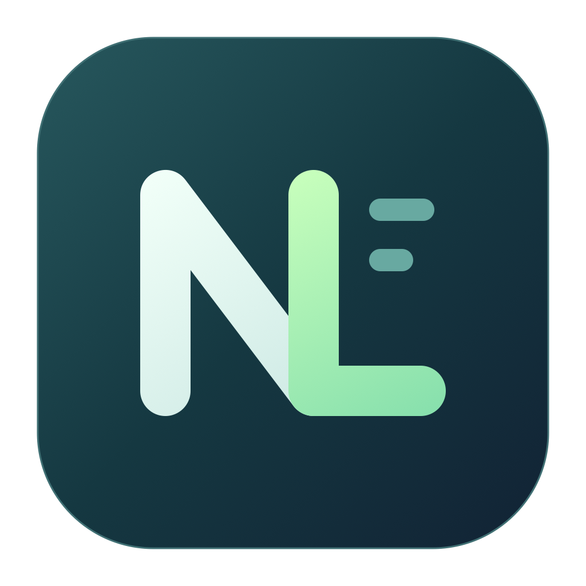

# NewsLingo



NewsLingo 是一款用真实新闻学英语的 macOS 应用。导入 AI、科技等主题的文章，按需查词和看译文，读完用理解题检验自己掌握了多少。

[下载 Apple 芯片版](https://github.com/qiuhonggang/NewsLingo/releases/latest) · [试用双语学习包](Distribution/AI-Skill/Genie-4-B1.newslingo) · [查看学习包格式](Distribution/AI-Skill/newslingo-news-import/references/format.md)

## 安装

需要 **macOS 15 或更新版本**。在 Releases 下载 `NewsLingo-*-macOS-arm64.dmg`，打开磁盘映像，把 NewsLingo 拖入「应用程序」。下载版使用临时签名，尚未经过 Apple 公证。若 macOS 提示无法验证开发者，请先核对 Release 中的 SHA-256，再按系统安全设置中的提示操作。

## 从一篇新闻开始

1. **导入。** 双击或拖入 `.newslingo` 学习包，也可以按 `⌘O` 打开文件。支持 TXT、Markdown、RTF、DOCX 和有文字层的 PDF。普通单语文档可做原文填空。
2. **精读。** 点击单词会在原句中标记它，并打开查词浮窗。本机语义模型只给词典义项排序。英英和英汉释义来自内置 **Open English WordNet 2025+** 或 macOS 已启用的词典。双语文章可以逐句看译文，也可以切换中英对照或全文中文。
3. **自测。** 在文末点击「标记为已读完」即可开始测验。提交后查看成绩、错题和对应原文。达到 80 分会标记通过，本次通过的文章安排在 3 天后复习，未通过的安排在次日。
4. **回顾。** 资料库默认显示今日导入的文章，可切换日期或按学习状态筛选。「本文统计」记录估算阅读时长、查词和测验成绩，「学习统计」汇总整体表现。

应用使用 SwiftUI、AppKit 和 Swift Charts，跟随 macOS 的浅色或深色外观。文章和学习记录保存在 `~/Library/Application Support/NewsLingo`，可在「设置 → 通用」打开数据文件夹。学习包制作和外部词典链接可以使用网络，导入后的阅读、内置词典查询和测验可在本机完成。

从早期版本升级时，先退出应用，将已有的 `Library.json` 移入上述目录，再启动新版。

点击窗口左上角的红色按钮会关闭窗口，NewsLingo 会继续在 Dock 运行。单击 Dock 图标可重新打开窗口，右键点击图标并选「退出」可结束应用。

## 用 AI 生成学习包

打开「设置 → AI 导入」查看内置 Skill 和示例。把 [`newslingo-news-import`](Distribution/AI-Skill/newslingo-news-import/) 加载到支持 Skills 的 AI 客户端，或把[使用说明](Distribution/AI-Skill/使用说明.md)和格式文档交给支持联网的 AI。

例如，可以要求 AI 从权威媒体或厂商官网选一篇真实科技新闻，生成 B1 英文导读、逐句中文译文和理解题。保存为 `.newslingo` 后双击导入，也可以在本机通过命令校验和打开。

```sh
"/Applications/NewsLingo.app/Contents/MacOS/NewsLingo" --validate "/绝对路径/文章.newslingo"
open -b app.newslingo.reader "/绝对路径/文章.newslingo"
```

校验会检查正文篇幅、双语对齐、题型、正确选项和原文证据。新闻事实和译文语义仍需根据原始来源核对。

## 从源码构建

需要 macOS 15+ 和 Xcode。在终端运行以下命令，构建本机架构的应用。

```sh
git clone https://github.com/qiuhonggang/NewsLingo.git
cd NewsLingo
./Scripts/package.sh "$PWD/.dist" release
open .dist/NewsLingo.app
```

快速检查词典和示例学习包。

```sh
./.dist/NewsLingo.app/Contents/MacOS/NewsLingo --system-check
./.dist/NewsLingo.app/Contents/MacOS/NewsLingo --validate Distribution/AI-Skill/Genie-4-B1.newslingo
```

| 路径 | 内容 |
| --- | --- |
| `Sources/NewsLingo/` | 阅读器、查词、测验、学习统计和本地资料库 |
| `Distribution/AI-Skill/` | 新闻采集 Skill、学习包格式和双语示例 |
| `Distribution/WordNet/` | 离线词典索引和第三方许可 |
| `Scripts/` | 构建打包、应用图标和词典索引生成脚本 |

## 词典来源

内置词典源自 [Open English WordNet 2025+](https://en-word.net/downloads) 和 Princeton WordNet，署名及许可见 [WordNet-LICENSE.txt](Distribution/WordNet/WordNet-LICENSE.txt)。仓库包含可直接用于构建的 SQLite 索引。如需重建，从官方页面下载 `english-wordnet-2025-plus.zip`，再运行以下命令。

```sh
python3 Scripts/build-wordnet.py english-wordnet-2025-plus.zip Distribution/WordNet
```
